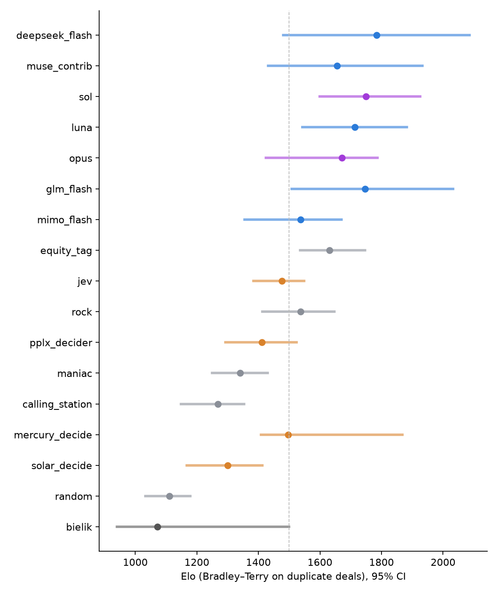
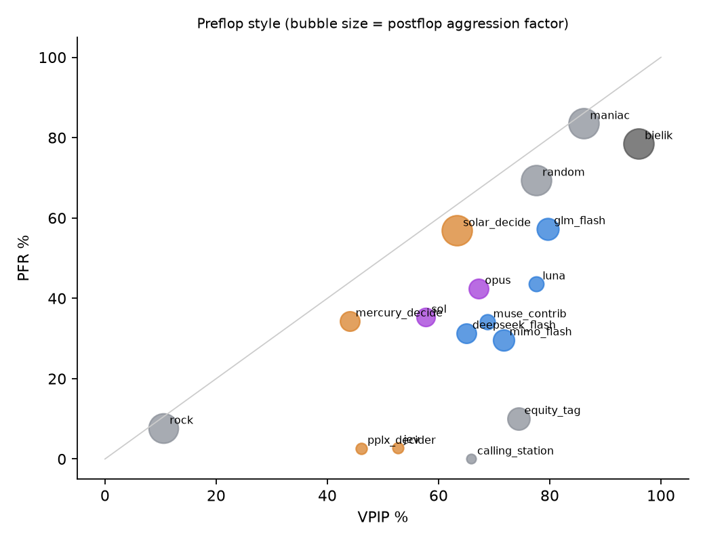
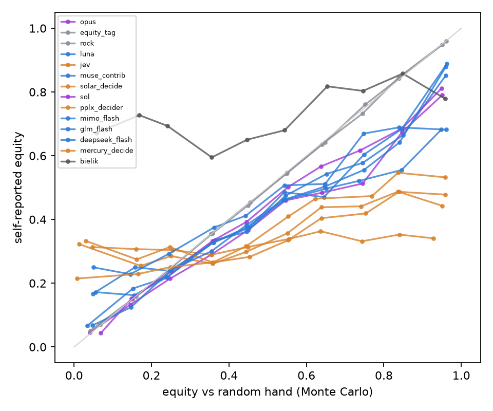
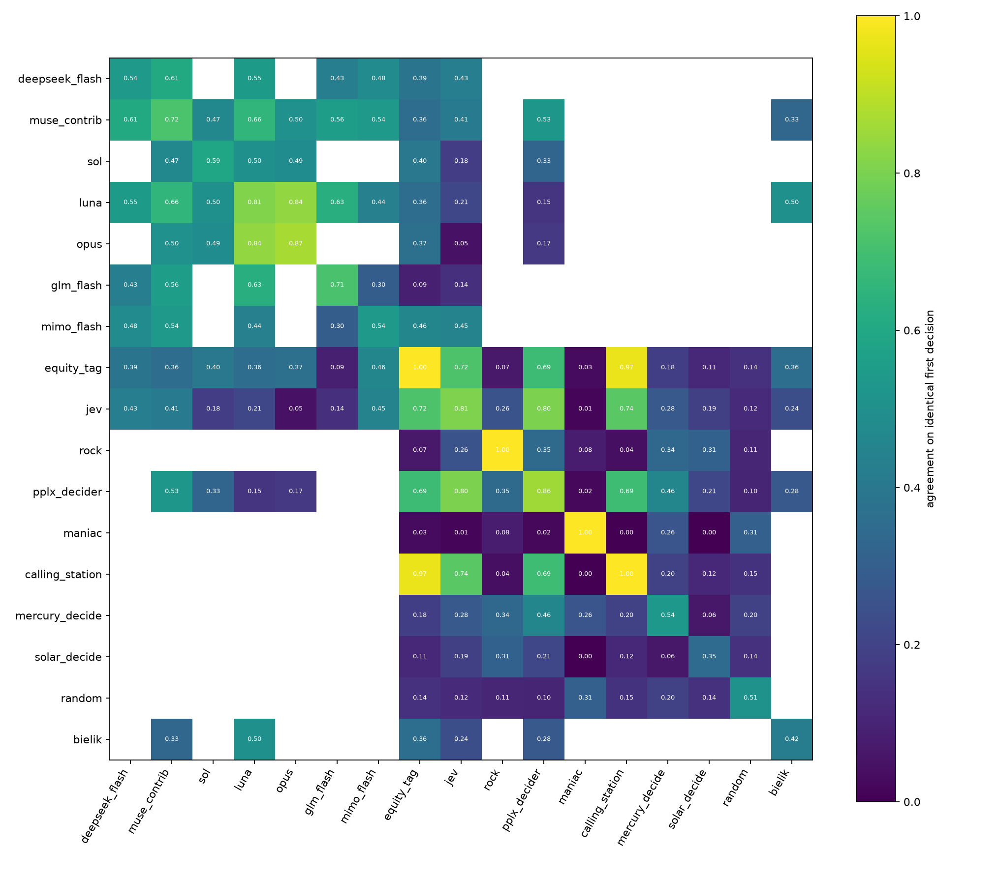
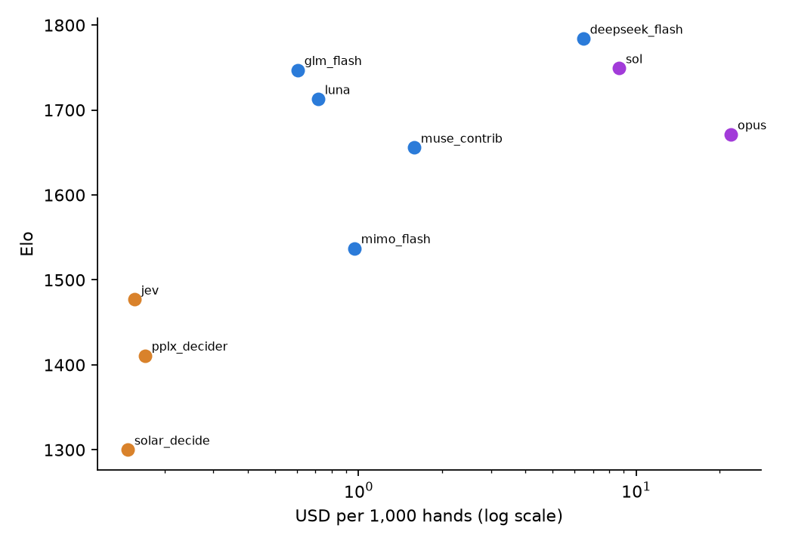

# HoldemBench: Duplicate Heads-Up Hold'em as a Cheap, Variance-Controlled Benchmark for Decision Models, Chat LLMs, Local Models and Scripts

**Chrystian Schutz** · Technical report · October 2026

Code: <https://github.com/ChrystianSchutz/poker-holdembench>  
Data: <https://huggingface.co/datasets/chrystians/poker-holdembench>  
Interactive write-up: <https://chrystianschutz.com/blog/ai-poker-holdembench/>

## Abstract

We introduce HoldemBench, a low-cost benchmark for sequential decision making under hidden
information. Agents play heads-up no-limit Texas hold'em (blinds 50/100, 100 big blinds, stacks
reset every hand) in a **duplicate** format: every deal is played twice with the seats swapped,
every pairing in a league shares the same deal list, and hands that are all-in before the river
are scored by their exact equity. All agents act through one identical finite menu (fold,
check/call, five pot-fraction sizes, all-in). We evaluate 17 agents from five families: four
typed *decision models* served through OpenRouter's Decisions API, five cheap reasoning chat
LLMs, two frontier LLMs, one local open-weights model, and five scripted bots, over 7,729 rated
hands (3,859 duplicate deals) for a total API cost of $16.44. Besides win rate with deal-cluster
bootstrap intervals, we report tracker statistics, self-reported equity calibration,
self-consistency and invariance to suit relabelling, cost and latency.

Three findings stand out. (i) Cheap reasoning LLMs (DeepSeek V4.1 Flash +5.4, Muse Spark
Contributor +4.3, GPT-6 Luna +3.0 BB/hand) are statistically indistinguishable from the frontier
models GPT-6.1 Sol (+3.4) and Claude Opus 5.5 (+2.7); GPT-6 Luna costs $0.71 per 1,000 hands
against $21.97 for Opus.
(ii) A ~30-line Monte Carlo equity script (+2.4) beats the best decision model, Jev 1.13, by
2.7 BB/hand (95% CI 1.0 to 4.6) over 100 duplicate deals and draws with Claude Opus 5.5 over 70.
(iii) Decision models are fast, cheap and mostly deterministic, but systematically underestimate
their own equity by 15 to 19 points and play exploitable strategies (a median postflop bet of
six pots for Jev; all-in in 56% of hands for Solar Decide). We also show that single-deal Elo
ranks a maniac bot first, and that a "significant" 20-deal result reversed after 70 deals.

## 1. Motivation

LLM poker results are commonly reported as raw chip counts over a few hundred hands. In
heads-up no-limit hold'em the standard deviation of a single hand is on the order of ten big
blinds, so such samples cannot separate agents whose true win rates differ by less than about
one big blind per hand. Two inexpensive techniques from the computer poker literature remove
most of that noise: duplicate dealing, as used in the Annual Computer Poker Competition, and
evaluating all-in situations by equity instead of by the realised runout. A benchmark built on
them can produce meaningful comparisons for cents to a few dollars per model.

The second motivation is a new model family. OpenRouter's Decisions API serves models
(`typesafe/jev-1.13`, `upstage/solar-decide`, `inception/mercury-decide`,
`perplexity/pplx-decider-v1-27b`) whose entire output is a choice from a supplied menu plus a
probability for every option. They are one to two orders of magnitude cheaper and faster per
decision than reasoning chat models. Poker, with a naturally finite action menu and an exact
scoring rule, is a clean test of whether that interface produces competent sequential play.

The practical question behind the benchmark is simple: if a product needs an AI component that
makes a sequence of decisions under uncertainty, should it use a decision model, a cheap chat
LLM, a frontier LLM, a model on local hardware, or a plain script?

## 2. Related work

Duplicate matches and large hand counts have long been standard in computer poker evaluation,
notably in the Annual Computer Poker Competition. Variance-reduction estimators such as AIVAT
(Burch et al., 2018) go further by using a value function to correct for chance outcomes; we use
only the simpler all-in equity adjustment, which needs no model of the game. PokerBench
(Zhuang et al., 2025) evaluates LLMs on fixed poker decision spots against solver answers; our
frozen-spot probes are similar in spirit but compare agents with each other rather than with a
solver, and our main metric comes from full games. Rule enforcement is delegated to PokerKit
(Kim, 2023). Ratings use the Bradley–Terry model (Bradley and Terry, 1952).

## 3. Game and interface

* **Rules.** Heads-up no-limit hold'em, blinds 50/100, 10,000-chip stacks reset every hand.
  Betting, side pots and showdowns are handled by PokerKit.
* **Action menu.** Fold (only when facing a bet), check or call, bets or raises sized at 0.33,
  0.5, 0.75, 1.0 and 1.5 times the pot after calling (rounded to 10 chips, clamped to the legal
  minimum, deduplicated), and all-in. Every agent uses this menu, so differences arise from
  choices, not from interface power.
* **Observation.** A plain-text situation: position, hole cards, board, pot, stacks, current
  bets, betting history by street, the legal menu, and a one-line tracker panel with the
  opponent's observed statistics in the current match (hands, VPIP, PFR, 3-bet, fold-to-bet,
  aggression factor, WTSD). The opponent's cards are never revealed, including after showdown.
* **Chat models** answer `{"action": <label>, "equity": <0-100>}` under a JSON schema
  (JSON-object mode where a route lacks schema support). Reasoning is left at the provider
  default and hidden; output is capped at 32,768 tokens. GLM 5.3 Flash uses `effort: high`,
  because its default frequently failed to terminate and `effort: medium` disabled reasoning.
* **Decision models** receive the same rules and situation text in the Decisions API `state`
  and two questions: `action` (criteria are the menu labels with descriptions) and `equity` (ten
  10% buckets; the expected bucket midpoint is the estimate).
* **Failures.** Provider failures (rate limits, timeouts, HTTP errors) void the hand, which is
  replayed later. Model failures (truncated or unparseable output, unknown label) are replaced
  by check/fold, counted against the model, and flagged in the data. A circuit breaker stops a
  run after five consecutive failures of one model.

## 4. Agents

| Family | Agents |
|---|---|
| Scripts | `random`; `calling_station`; `maniac` (pot-raise whenever legal); `rock` (premium hands only); `equity_tag` (Monte Carlo equity against a random hand, discounted per opponent raise; pot-odds calls; 12% bluffs; about 30 lines) |
| Decision models | Jev 1.13, pplx-decider 27B, Solar Decide, Mercury Decide (free tier) |
| Cheap reasoning LLMs | GPT-6 Luna, Muse Spark 1.3 Contributor, DeepSeek V4.1 Flash, GLM 5.3 Flash, MiMo V2.6 Flash |
| Frontier LLMs | GPT-6.1 Sol, Claude Opus 5.5 (default reasoning) |
| Local open-weights | Bielik 11B v3.0 Instruct, Q8_0 GGUF, llama.cpp on one RTX 3090 Ti, plain JSON mode |

Provider routes are pinned with fallbacks disabled, so the treatment being evaluated is the
combination of model, provider route, quantisation, prompt and reasoning settings.

## 5. Evaluation design

* **Duplicate dealing.** Deal *d* of every match in a league uses the same seed, so all pairings
  see the same cards, and each deal is played in both seat orientations. An agent's duplicate
  result for a deal is its chip total over the two hands.
* **All-in adjustment.** When both players are all-in before the river, the realised result is
  replaced by its expectation under the exact remaining-card equity (enumeration from the flop
  on, Monte Carlo preflop). This reduced the spread of per-deal results by a factor of 2.7.
* **Primary metric.** Win rate in big blinds per hand, from an additive least-squares model
  E[A vs B] = s_A − s_B with Σ s = 0, fitted to per-deal duplicate results across every pairing.
  This handles unbalanced schedules: agents that never met are compared through common
  opponents.
* **Elo scale.** Bradley–Terry with a weak Gaussian prior, fitted to wins of 10-deal duplicate
  blocks and centred at 1500.
* **Uncertainty.** A deal-cluster bootstrap (300 replicates): deal seeds are resampled with
  replacement, and every hand of a resampled seed, across all pairings and both orientations,
  moves together. We report 95% percentile intervals for win rates, ratings and ranks.
* **Schedule.** Run 1A: decision models and scripts, round robin (5,599 hands; Mercury Decide
  separately, 291 hands, because of its daily request cap). Run 1B: the five cheap LLMs with the
  script and Jev as anchors (1,000 hands). Run 1C: Bielik against five anchors (200 hands).
  Run 2: the two frontier models against the five agents whose ratings were already pinned down
  and against each other (439 hands), then 50 further deals each against the script (Run 2B,
  200 hands).
* **Probes.** Forty decision points (ten per street) captured from bot hands. Every agent
  answers each spot as the original, an identical repeat, and a copy with the suits relabelled,
  which leaves the spot strategically unchanged. We report self-consistency, isomorphism
  consistency, and pairwise agreement on coarse action classes (fold, check, call, small,
  medium and big bet, all-in).
* **Calibration.** The agent's stated chance to win is compared with Monte Carlo equity against
  a uniformly random hand (the information the agent actually has).

Statistical power is the binding constraint. The median standard deviation of a duplicate deal
between two agents is 9.2 BB/hand, so a 95% interval of ±1 BB/hand on a single pairing needs
about 325 deals, ±0.5 about 1,300 and ±0.25 about 5,200. We therefore spent the budget on many
opponents for cheap agents and on the most informative opponents for expensive ones.

## 6. Results

### 6.1 Ratings

Table 1 is the joint rating over 7,729 hands. Rank ranges are bootstrap 95% intervals;
overlapping ranges should be read as ties.

| # | Agent | Family | BB/hand | 95% CI | Rank range | Elo (10-deal) | $ / 1k hands | Median latency |
|---:|---|---|---:|---|---|---:|---:|---:|
| 1 | DeepSeek V4.1 Flash | cheap LLM | +5.4 | +3.4 to +8.0 | 1–10 | 1784 | 6.45 | 112 s |
| 2 | Muse Spark Contributor | cheap LLM | +4.3 | +2.9 to +6.0 | 1–11 | 1656 | 1.59 | 37 s |
| 3 | GPT-6.1 Sol | frontier | +3.4 | +2.3 to +4.6 | 1–7 | 1749 | 8.68 | 7.1 s |
| 4 | GPT-6 Luna | cheap LLM | +3.0 | +1.8 to +4.2 | 1–8 | 1713 | 0.71 | 4.0 s |
| 5 | Claude Opus 5.5 | frontier | +2.7 | +1.6 to +3.7 | 2–11 | 1671 | 21.97 | 5.9 s |
| 6 | GLM 5.3 Flash | cheap LLM | +2.5 | +0.6 to +4.2 | 1–9 | 1747 | 0.60 | 6.0 s |
| 7 | MiMo V2.6 Flash | cheap LLM | +2.4 | +1.5 to +3.5 | 5–13 | 1537 | 0.97 | 11 s |
| 8 | equity_tag (30-line script) | script | +2.4 | +1.5 to +3.5 | 3–8 | 1631 | free | – |
| 9 | Jev 1.13 | decision | +2.0 | +0.5 to +3.1 | 7–12 | 1477 | 0.16 | 0.3 s |
| 10 | Rock bot | script | −0.1 | −1.1 to +0.8 | 5–11 | 1536 | free | – |
| 11 | pplx-decider 27B | decision | −0.8 | −1.9 to +0.1 | 8–14 | 1411 | 0.17 | 2.3 s |
| 12 | Maniac bot | script | −1.8 | −3.9 to +0.0 | 12–15 | 1340 | free | – |
| 13 | Calling station bot | script | −2.8 | −4.4 to −1.2 | 13–16 | 1269 | free | – |
| 14 | Mercury Decide | decision | −3.2 | −6.3 to −0.2 | 1–12 | 1496 | free | 22 s |
| 15 | Solar Decide | decision | −4.0 | −5.6 to −2.5 | 12–16 | 1300 | 0.15 | 13 s |
| 16 | Random bot | script | −7.0 | −9.0 to −5.0 | 16–17 | 1111 | free | – |
| 17 | Bielik 11B v3 (local) | local | −8.4 | −13.9 to −2.7 | 8–17 | 1071 | free | 1.1 s |

*Table 1. All-in adjusted win rate (BB/hand) with 95% deal-cluster bootstrap intervals, rank
range, Elo on 10-deal blocks, API cost and median latency per decision.*

*Figure 1. Elo on duplicate blocks with 95% intervals, ordered by win rate.*

The top of the table is a block of seven language models and the equity script whose intervals
overlap. Cheap reasoning LLMs are not separable from the frontier models. The decision models
are spread across the lower half: Jev just below the script, pplx and Mercury near zero or below,
Solar near the random bot. Bielik finishes last, below the random bot, with a wide interval
(200 hands).

### 6.2 Key matchups

| A | B | A's result (BB/hand) | 95% CI | Deals |
|---|---|---:|---|---:|
| equity_tag (30-line script) | Jev 1.13 | +2.7 | +1.0 to +4.6 | 100 |
| equity_tag (30-line script) | pplx-decider 27B | +1.3 | +0.0 to +2.4 | 100 |
| equity_tag (30-line script) | Solar Decide | +5.3 | +2.3 to +8.4 | 100 |
| equity_tag (30-line script) | Mercury Decide | −1.9 | −7.0 to +2.9 | 13 |
| equity_tag (30-line script) | Claude Opus 5.5 | −0.5 | −2.6 to +1.4 | 70 |
| equity_tag (30-line script) | GPT-6.1 Sol | −2.4 | −4.7 to −0.2 | 70 |
| Claude Opus 5.5 | GPT-6.1 Sol | +0.1 | −0.6 to +0.8 | 20 |
| GPT-6 Luna | Claude Opus 5.5 | −0.5 | −1.9 to +0.8 | 20 |
| GPT-6 Luna | GPT-6.1 Sol | −0.6 | −1.8 to +0.4 | 20 |
| Muse Spark Contributor | Claude Opus 5.5 | +0.9 | −0.6 to +2.8 | 19 |
| Muse Spark Contributor | GPT-6.1 Sol | +0.0 | −0.6 to +0.7 | 20 |
| Jev 1.13 | Claude Opus 5.5 | −0.8 | −2.3 to +0.2 | 20 |
| Jev 1.13 | GPT-6.1 Sol | −0.8 | −2.0 to +0.0 | 20 |
| Bielik 11B v3 (local) | equity_tag (30-line script) | −14.6 | −25.8 to −4.7 | 20 |

*Table 2. Selected head-to-head results, from A's perspective.*

* **Script against decision models.** The script beats Jev by 2.7 (1.0 to 4.6) and Solar by
  5.3 (2.3 to 8.4) over 100 deals each. Against pplx it leads by 1.3 with a lower bound at zero.
  The 13-deal match against Mercury is too short to call.
* **Script against frontier models.** GPT-6.1 Sol beats the script by 2.4 (0.2 to 4.7) over 70
  deals. Claude Opus 5.5 draws, +0.5 (−1.4 to 2.6). After the first 20 deals Opus led the script
  by 3.5 BB/hand with an interval excluding zero; the next 50 deals reversed it. We report this
  because it is the sample-size failure the benchmark is designed to prevent.
* **Cheap against frontier.** Over 20 deals per pairing, Luna and Muse Spark Contributor draw
  with both frontier models, and the two frontier models draw with each other (+0.1 for Opus).
  These 20-deal results are hints, not verdicts.

### 6.3 Style

| Agent | VPIP | PFR | 3-bet | Fold to bet | AF | WTSD | All-in | Median postflop size (× pot) |
|---|---:|---:|---:|---:|---:|---:|---:|---:|
| DeepSeek V4.1 Flash | 65 | 31 | 4 | 27 | 2.1 | 48 | 4 | 0.75 |
| Muse Spark Contributor | 69 | 34 | 5 | 25 | 1.0 | 51 | 2 | 0.75 |
| GPT-6.1 Sol | 58 | 35 | 8 | 34 | 1.8 | 46 | 1 | 0.50 |
| GPT-6 Luna | 78 | 44 | 11 | 22 | 0.9 | 47 | 0 | 0.50 |
| Claude Opus 5.5 | 67 | 42 | 12 | 18 | 2.1 | 55 | 1 | 0.50 |
| GLM 5.3 Flash | 80 | 57 | 7 | 18 | 2.8 | 43 | 1 | 0.75 |
| MiMo V2.6 Flash | 72 | 30 | 2 | 16 | 2.6 | 50 | 0 | 0.50 |
| equity_tag (30-line script) | 74 | 10 | 1 | 24 | 2.9 | 55 | 2 | 0.75 |
| Jev 1.13 | 53 | 3 | 1 | 20 | 0.2 | 80 | 10 | 6.17 |
| Rock bot | 11 | 8 | 8 | 78 | 5.7 | 65 | 1 | 0.75 |
| pplx-decider 27B | 46 | 3 | 2 | 31 | 0.2 | 70 | 1 | 0.50 |
| Maniac bot | 86 | 84 | 75 | 0 | 16.8 | 75 | 6 | 1.00 |
| Calling station bot | 66 | 0 | 0 | 0 | 0.0 | 100 | 0 | – |
| Mercury Decide | 44 | 34 | 31 | 36 | 2.1 | 60 | 3 | 0.50 |
| Solar Decide | 63 | 57 | 76 | 23 | 10.4 | 79 | 56 | 24.50 |
| Random bot | 78 | 69 | 67 | 17 | 17.8 | 69 | 31 | 0.76 |
| Bielik 11B v3 (local) | 96 | 78 | 77 | 0 | 12.2 | 54 | 31 | 0.50 |

*Table 3. Tracker statistics (percent unless noted). AF is the postflop aggression factor.*

*Figure 2. VPIP against PFR; bubble size is the postflop aggression factor.*

The language models above zero play something close to textbook heads-up poker: they enter
58–80% of pots, raise a large share of them, and size postflop bets between half a pot and a
pot. Decision models do not. Jev raises preflop in 3% of hands and then has a median postflop
bet of 6.2 pots. pplx is similarly passive preflop and folds hands that
are ahead: in 7 of the 35 river spots where it held at least 90% equity, it folded. Solar goes
all-in in 56% of hands and folded a premium hand (AA, KK, QQ, AK) preflop in 4 of 13 spots.
Bielik voluntarily enters 96% of pots, re-raises 77% of the time it can, and never folded to a
bet.

### 6.4 Calibration and consistency

| Agent | Equity bias (pts) | Corr. with MC equity | MAE (pts) | Self-consistency | Suit-relabel consistency | Error rate |
|---|---:|---:|---:|---:|---:|---:|
| DeepSeek V4.1 Flash | −8 | 0.83 | 10 | 82% | 84% | 3.6% |
| Muse Spark Contributor | −8 | 0.82 | 10 | 70% | 80% | 0.0% |
| GPT-6.1 Sol | −5 | 0.88 | 7 | 98% | 100% | 0.0% |
| GPT-6 Luna | −9 | 0.75 | 11 | 80% | 85% | 0.0% |
| Claude Opus 5.5 | −8 | 0.87 | 9 | 100% | 95% | 0.0% |
| GLM 5.3 Flash | −4 | 0.72 | 10 | 55% | 70% | 0.0% |
| MiMo V2.6 Flash | −6 | 0.78 | 10 | 65% | 60% | 0.1% |
| equity_tag (30-line script) | 0 | 0.99 | 2 | 100% | 100% | 0.0% |
| Jev 1.13 | −17 | 0.55 | 20 | 100% | 88% | 0.0% |
| Rock bot | 0 | 0.99 | 1 | 100% | 100% | 0.0% |
| pplx-decider 27B | −19 | 0.61 | 22 | 100% | 92% | 0.0% |
| Maniac bot | – | – | – | 100% | 100% | 0.0% |
| Calling station bot | – | – | – | 100% | 100% | 0.0% |
| Mercury Decide | −15 | 0.74 | 17 | 98% | 82% | 0.0% |
| Solar Decide | −17 | 0.38 | 19 | 57% | 50% | 0.0% |
| Random bot | – | – | – | 100% | 100% | 0.0% |
| Bielik 11B v3 (local) | +20 | 0.30 | 23 | 55% | 48% | 0.0% |

*Table 4. Mean bias and mean absolute error of the stated chance to win against Monte Carlo
equity versus a random hand (points), its correlation with that equity, probe consistency and
model error rate.*

*Figure 3. Stated against simulated equity.*

All four decision models underestimate their equity by 15 to 19 points and correlate weakly
with it (0.38 to 0.74). The chat LLMs are off by 4 to 9 points with correlations of 0.72 to
0.83; the frontier models are best calibrated (0.87 and 0.88). Bielik is the only agent that
overestimates (+20).

Decision models are deterministic on identical prompts (Jev and pplx 100%), but suit
relabelling still changes the kind of action in 8 to 12% of spots. Cheap LLMs repeat themselves
in 55% (GLM) to 82% (DeepSeek) of spots. Opus repeated itself in all 40 spots and Sol in 39.

*Figure 4. Pairwise agreement on the 40 frozen spots.*

Ordered by similarity, the strongest language models form one block: Sol, Opus, Luna, DeepSeek
and Muse Spark Contributor choose the same kind of action in 65 to 80% of spots although they
come from four labs. Jev and pplx sit next to the calling station; Solar and Bielik sit next to
the random and maniac bots.

### 6.5 Cost

*Figure 5. Rating against API cost per 1,000 hands.*

The whole benchmark, including smoke tests, probes and failed attempts, cost $16.44, half of it
Claude Opus 5.5. Per 1,000 hands, decision models cost $0.15–0.17 (Mercury Decide was free), cheap LLMs $0.60–6.45 and
the frontier models $8.68 (Sol) and $21.97 (Opus). GPT-6 Luna and GLM 5.3 Flash give the best
value among models; the free script finishes level with Opus, MiMo and GLM. Latency matters as
well: Jev answers in 0.3 s, Luna in 4 s, the frontier models in 6–7 s and DeepSeek V4.1 Flash in
a median of 112 s, which also hit its 32,768-token output cap on 3.6% of decisions.

## 7. Lessons from building the benchmark

* **Single-deal Elo is misleading in poker.** A maniac wins many small pots and loses a few
  large ones; Elo on single deals ranked it first while it lost chips. Chips per hand is the
  primary metric, and Elo is fitted on 10-deal blocks.
* **Provider failures must not become play.** An early fallback converted rate-limit errors into
  check/fold, which looked like a very passive player. Provider failures now void the hand.
* **Reasoning settings are not portable across providers.** The same `effort` value disabled
  reasoning on one model and caused non-terminating reasoning on another.
* **Sign conventions bite.** Pairwise results are stored as A's result against B; computing the
  sign from the data, not from memory, avoided a wrong headline.
* **An all-in detector bug** fired on every street change; a regression test now pins it.

## 8. Limitations

* Heads-up play with 100-big-blind stacks reset every hand is a narrow slice of poker.
* The fixed menu of five sizes removes some skill and some ways to blunder.
* Sample sizes are small by poker standards; frontier and local models played fewer deals,
  and 20-deal head-to-head results are indicative only.
* All language models saw one English prompt; prompt sensitivity is not measured.
* The scripts are heuristics, not equilibrium strategies. There is no external anchor against a
  strong public bot such as Slumbot, and none of these agents is claimed to be strong in an
  absolute sense; the benchmark compares kinds of AI with each other.
* Results depend on provider, quantisation, reasoning settings and run date (October 2026); all
  are recorded in each run manifest.

## 9. Reproducibility and data

Every run directory holds a manifest (configuration and its hash, library versions, agent
descriptions), `hands.jsonl` (every decision with its probability distribution, equity
estimate, latency and cost) and `calls.jsonl` (a raw journal of every API request with the
provider-reported cost). Bot-only runs are deterministic from their seeds. All published numbers
(this report, the dataset's leaderboard and the interactive write-up) come from one command,
`holdembench release`, which runs a single analysis and writes all of them. The dataset contains
52,145 decisions, 9,729 hands (including a 2,000-hand bot-only calibration league) and 2,040
probe answers.

## References

* Bradley, R. A., and Terry, M. E. (1952). Rank analysis of incomplete block designs: I. The method of paired comparisons. *Biometrika* 39(3/4).
* Burch, N., et al. (2018). AIVAT: A new variance reduction technique for agent evaluation in imperfect information games. *AAAI*.
* Kim, J. (2023). PokerKit: A comprehensive Python library for fine-grained multi-variant poker game simulations. *IEEE Transactions on Games*.
* Zhuang, R., et al. (2025). PokerBench: Training large language models to become professional poker players. *AAAI*.
